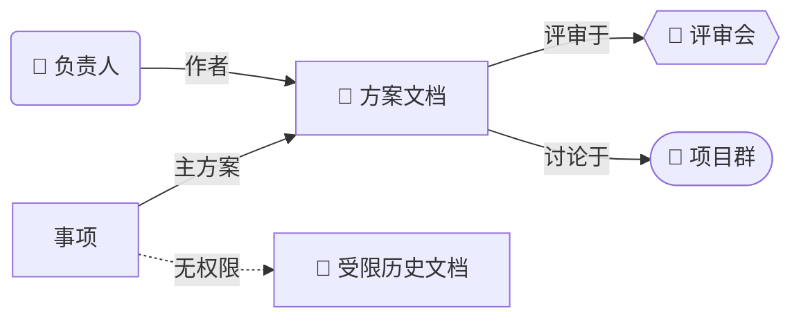

# 检索与证据规则

## 按需选择 CLI 入口

所有查询显式使用 `--as user`。先读对应领域 Skill，再查看目标 shortcut 的 `--help` 获取准确参数。下表列入口，不预设各命令的关键词参数相同。

| 目的 | 入口 |
|---|---|
| 文档、Wiki、表格发现 | `docs +search`；`drive +search` 是同类入口，通常不重复调用 |
| 群发现 | `im +chat-search`，支持关键词和 `--member-ids` |
| 跨群消息发现 | `im +messages-search`，先限事项/人员/时间 |
| 群消息/话题回复 | `im +chat-messages-list`；已知消息或话题后按需 `im +messages-mget` / `im +threads-messages-list` |
| 会议证据 | `minutes +search` → `minutes +detail`；必要时 `vc +search` / `vc +detail` / `calendar +search-event` 定位会议和 minute_token |
| 文档正文 | `docs +fetch`，先 `outline` 后 `section`/`keyword`/`range` |
| 评审评论 | `drive file.comments list`；需要回复时 `drive file.comment.replys list`，先看 help 或读取 lark-drive 对应参考 |
| Wiki 类型与真实 token | `wiki +node-get` 或 `drive +inspect`，检查 `obj_type` / `obj_token` |
| 成员与人员定位 | `im +chat-members-list` / `contact +search-user` |
| 表格内部数据 | 解析后按 `lark-sheets` / `lark-base` 指引读取所需区域 |

原文的 `drive +list-comments` 在已核对的 CLI 中不存在，不能直接照抄。不要用未经验证的 URL 模板伪造消息、会议或人的链接；缺少链接时保留真实 ID 和定位信息。

追溯历史决策时注意评论的 `--is-solved` 过滤：默认只看未解决评论可能漏掉已经收口的评审。按需分别取已解决与未解决评论，并按评论 ID 去重；不要把默认结果当作全部评审记录。

## 发现与扩散

1. **问题驱动的跨域发现**：先列出需要回答的现状、决策理由、历史节点和未闭环事项。优先读用户种子；没有种子时先做文档/群的窄查询，再根据缺口进入消息/妙记。完整交接需评估四域覆盖，但不要求每个关键词机械地四搜；跳过某域时记录“用户限定/权限受限/已有证据覆盖/预算不足”等理由，不声称已查该域。首次探测成功后才可并行独立请求。
2. **枢纽优先**：优先打开“汇总/索引/One Page/交接”类页面，沿其引用找到主方案、任务表和讨论群；从正文背景收集旧称、别名和前身术语。
3. **读内容而非标题推断**：结构未知先查 outline，再只读相关章节。已有术语直接 keyword。每次联网请求绑定 question_ids；全文读取必须记录 full_read_reason。响应落地到每次调用的独立文件，正文不直接打印到工具输出。超过 16 KB 的响应先用本地 excerpt（默认 6000 字符、最多 8 个命中）或 rg 定位再窄读；出现 truncated 必须记录未覆盖范围，不把截断片段当全文已读。字段投影只用于显示，原始响应保留。
4. **反查讨论现场**：拿关键文档 token 搜消息，找分享、评审和决策发生的群；读关键决定前后的时间窗口，以及评论与回复中的取舍理由。群成员只用于找到有关的人，不批量抓取无关通讯录。
5. **有界别名搜索**：只将高价值别名用于尚未回答的问题；前史群名进群域，决策原话进消息域，方案旧称进文档域。命中线索后再扩到相关域，不把每个别名重跑四搜。宽泛词结合人员、时间或群范围，按事项相关性过滤和去重。
6. **处理引用类型**：`/docx/` 的 token 可直接读正文；`/wiki/` 先解析类型与真实 token，再交给 docs/sheets/base。嵌入表格不等于已读其内部数据；只在与问题相关时下钻。

## 前史检查

时间线起点接近主群创建日时，检查是否遗漏了定名前的讨论，不能据此断言此前必有其他群。

- 从已有材料提取有辨识度的旧称/词素候选，并绑定尚未回答的问题；没有具体前史缺口则跳过，不强制单词素搜索。“主动”“智能”等宽泛词不得单独全域搜索，须加项目、群、人员或时间范围。
- 查主群创建前的消息、旧方案、评审会议；对已解析的关键成员按需使用 `im +chat-search --member-ids` 寻找候选前史群。
- 只有用户范围、权限或止损条件允许时才继续补查，不为完成固定清单突破限制。未完成的检索写入覆盖缺口。
- 无论搜索多少轮，“本次范围内未检索到”都不能升级为“历史不存在”。在会议或文档中找到前史，也不能据此排除群聊中的前史。

## 来源与去重

对每个相关实体保存最小信息：类型、真实 ID/token、标题、来源 URL 或定位、事件时间/时区、相关性、访问状态、发现路径。按 `(类型, canonical ID/token)` 去重，同一 Wiki 与其承载对象保留映射，不重复计数。

关系边只记录有来源支持的关系：作者、引用、分享、评审、参会、成员等。共同出现或群成员身份不等于负责人、决策人；对后两者需要明确证据。

消息证据至少包含群名/ID、消息 ID、发送时间和适量原文/摘要；会议证据保留会议 ID 与实际日期。不要把文档更新时间当作决策时间。互相冲突的口径分别列出来源、时间和待确认点。

本地记忆、旧报告或知识库仅用作线索，影响本次结论的事实需要实时回查。受限文档的已知标题可以列为待移交实体，但不能猜测其正文。

逐次保存 fetched_at（响应封存时间）、recorded_at（证据登记时间）、revision、读取范围、完整 argv 和执行环境。不要给所有来源填生成报告的时间。来源标 primary（原始方案/讨论）、secondary（摘要/转述）或 direct（代码/运行证据）；搜索摘要只用于发现，不能冒充正文。失败响应保留在原调用目录，重试使用新 ID，不能覆盖失败文件。

关键事实及其依据写入 [evidence.json](state.md)，来源实体和事实分别去重。同一文档新章节带来的新决策理由属于有效收益；同一结论被十个文档转述不算十个新事实。查询前检查本次缓存；缓存键至少含用户身份、资源 ID、revision/读取时间和范围。权限、身份或版本变化时不能直接复用旧结果。

## 妙记按需读取

先读 `lark-cli skills read lark-minutes` 与 `minutes +detail --help`。本机已有只读入口，无需先把妙记转换为文档：

```bash
lark-cli minutes +detail --minute-tokens MINUTE_TOKEN --summary --todo --chapter --as user
```

摘要与待办回答不了具体取舍、发言人或争论经过时，再读取已有逐字稿到任务目录：

```bash
lark-cli minutes +detail --minute-tokens MINUTE_TOKEN --transcript --output-dir ./transcripts --as user
```

先本地搜索关键术语/章节/时间窗口，只读相关上下文；不把整个逐字稿回灌模型。会议 AI 摘要应标为摘要证据，无法确认的拍板人和精确原话不能据此补写。若正文已转成可访问文档且足够回答问题，可复用，不重复抓全文。没有现成逐字稿、接口不支持或无权限时记录具体缺口；不下载音视频、不发起上传转写，也不擅自使用 `--overwrite` 覆盖既有材料。

## 权限、空结果与止损

- `missing_scope` 是授权缺口；明确 403 才标注无权限；搜索为空可能是名称、范围、索引或接口覆盖问题，标注“未检索到”，不要混同。
- 话题群的 `chat-messages-list` 空结果不证明群内无消息。若已知可访问的消息/话题 ID，尝试受支持的线程读取；仍不支持就记录接口覆盖缺口，不反复请求同一空接口。
- 每轮记录待回答问题，以及新增关键事实 ID、已解决问题 ID、新矛盾 ID；三类均为空才算无有效收益，不按实体增量计分。分支连续两轮无有效收益且没有具体待验证的高价值线索时暂停。若发现明确线索，可在剩余预算内定向补查；预算优先，不无限延长。
- “轮”是为一个明确问题执行的一组有界查询，不是每翻一页就独立记一轮。当前候选只有旧实体也可读新章节/回复；新群与新文档若不影响问题，不据此重置收益计数。
- 相同方法失败两次后诊断或换路线，不机械重试。出现 Keychain、身份或网络错误，立即撤销该执行环境的探测成功状态并停止批量；更换 runner/sandbox 后重新单次探测。对象级 403 不意味着整个认证失效，分别记录对象权限与接口 scope 缺口。
- 默认使用有限分页，只有已有高价值线索支撑才翻页；不默认 `--page-all`。记录未读完的分页范围、时间范围和查询限制。
- 联网 CLI 每次尝试计一次，翻页、重试和调用前置失败也计数；底层 SDK 可能发多次 HTTP 请求，不把该计数宣传成 HTTP 总数。用 run_state.py prepare 在本地文件锁内逐个预留，pending 也占额度，全部预留成功后才并行独立请求；帮助与本地缓存不计联网额度。被拒绝的预留不得发出；若批次只预留了一部分，可执行已预留部分并保留其他缺口。
- 每次调用后 finish 封存，每轮开始查 status。超限不再扩展检索；collection 耗尽进入预留交付阶段，总预算耗尽只落盘和说明缺口。暂停/恢复保留已耗额度；初始计划只在首次请求前选择一次，此后增额需用户明确指令。不得篡改时钟、切阶段或以本地分析名义绕过总时限。

## 关系图

背景关系图使用 `graph LR`，中心为事项，最多 30 个重要实体；节点标签标类型，边标关系。技术任务另画组件与请求流，见技术调查模式。图保存为 `.mmd` 并与正文同源；本地语法未验证、语法通过和实际渲染通过分别标记。图是导航，完整清单在正文。示例结构需用真实证据替换：



DocxXML 支持 `<whiteboard type="mermaid" path="@relations.mmd"></whiteboard>`，相对文件与正文置于同一产物目录；执行前按本机格式文档确认。图中无权限实体必须确有来源且确实受限，不能给普通空搜索画无权限边。

检查创建响应中的 warnings、降级信息和资源 block。若画板渲染失败，保留 Mermaid 文件并在正文提供关系清单、标明缺失；已有授权内可修复本次新建文档，不改动来源内容。不把空白资源块当作成功的关系图。
